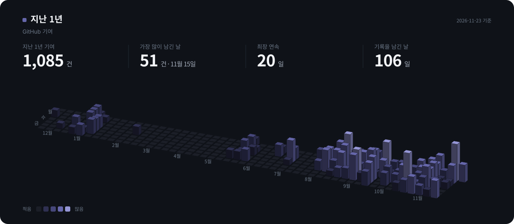
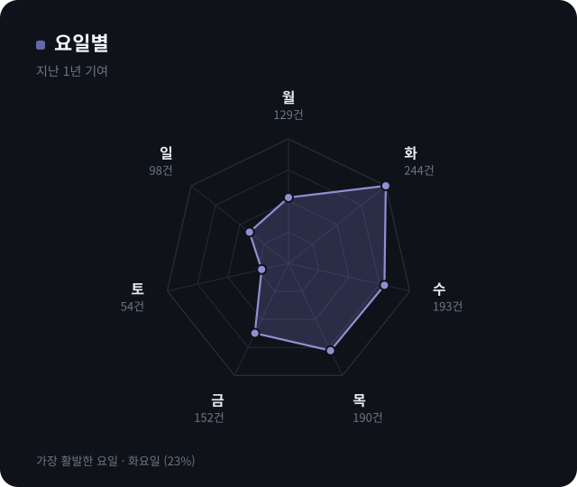
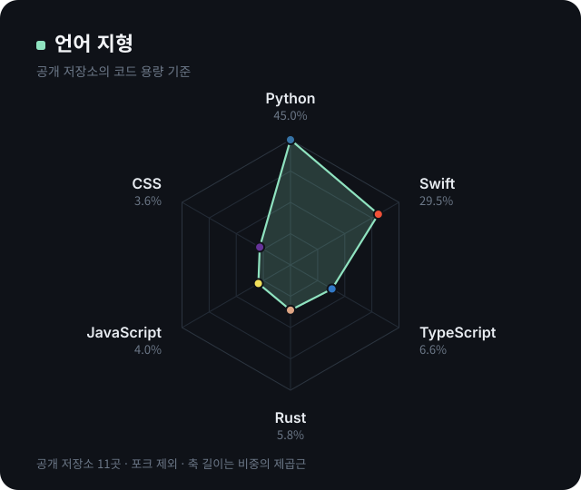
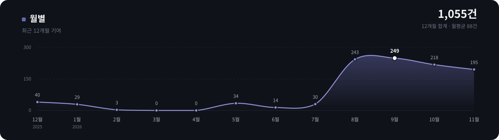

  

### 안녕하세요, 1030.fx입니다.

서울에서 1인 스튜디오 <a href="https://studioq.dev"><b>StudioQ</b></a>를 하고 있어요. 
기획부터 디자인, 개발까지 혼자 해요.

 

## StudioQ

<table>
  <tr>
    <td width="50%" valign="top">
      <h3><a href="https://loveus.studioq.dev">loveus</a></h3>
      <b>나의 주기, 우리의 날.</b> 
      생리 주기를 기록하고 연인과 달력을 같이 쓰는 앱이에요. 지금 한국 App Store에 있고, Android 버전도 만들고 있어요.
        
      
       SwiftUI
    </td>
    <td width="50%" valign="top">
      <h3><a href="https://qommon.studioq.dev">Qommon Sense</a></h3>
      <b>넘길수록 쌓이는 오늘의 상식.</b> 
      단서를 보고 단어를 맞히는 상식 카드 앱이에요. 모르는 카드는 잊을 때쯤 다시 나와요.
        
      
       SwiftUI
    </td>
  </tr>
</table>

 

## 사이드 프로젝트

<table>
  <tr>
    <td width="50%" valign="top">
      <h3><a href="https://github.com/lr3mon/DiskBloom">DiskBloom</a></h3>
      Mac 저장 공간을 원형 차트로 보여주는 앱이에요. 파일 정보는 Mac 밖으로 나가지 않아요.
        Swift · SwiftUI · macOS 14+
    </td>
    <td width="50%" valign="top">
      <h3><a href="https://github.com/lr3mon/anchor">anchor</a></h3>
      왜 그렇게 정했는지 적어두는 결정 기록 도구예요. 메뉴바 앱과 CLI가 같은 기록을 써요.
        Swift · SQLite · <code>brew install lr3mon/tap/anchor</code>
    </td>
  </tr>
  <tr>
    <td width="50%" valign="top">
      <h3><a href="https://github.com/lr3mon/Korean-job-search">Korean-job-search</a></h3>
      공고 찾기부터 지원서, 면접 준비까지 AI 에이전트랑 같이 하는 취업 준비 작업 공간이에요.
        Python · Agent Skills
    </td>
    <td width="50%" valign="top">
      <h3><a href="https://github.com/lr3mon/hookcut48">hookcut48</a></h3>
      작은 온라인 브랜드용 광고 소재 제작 서비스를 팔아 보려고 만든 판매 페이지예요.
        Python · HTML
    </td>
  </tr>
</table>

 

## 활동

  

  
  

  

 

## 쓰는 도구

  
  
  
  
  
  
  

 

## 연락

<a href="https://studioq.dev">studioq.dev</a> · <a href="mailto:Official@studioq.dev">Official@studioq.dev</a> · <a href="https://www.instagram.com/1030.fx/">Instagram</a> · <a href="https://www.threads.com/@1030.fx">Threads</a>
